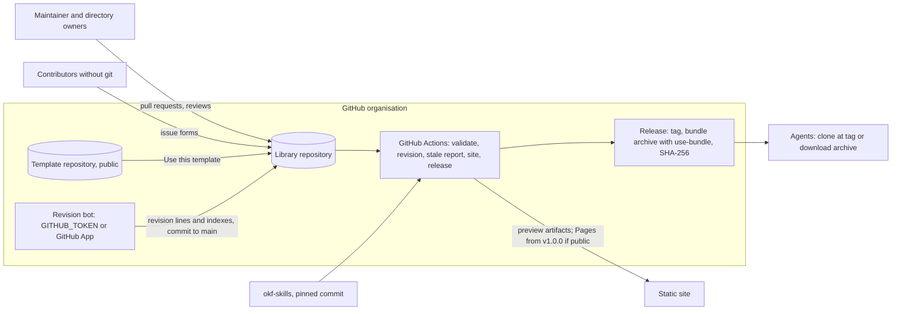

> This document specifies how the OKF library template is built. It implements the requirements in `OKF Library Template - Software Requirements Spec.md` on the reference technology stack recommended in `OKF library technology stack options.md`: GitHub on free tiers, Python profile tooling, JSON Schema, a pinned OKF conformance checker, a GitHub template repository with set-up scripts, and a site built from one `mkdocs.yml` by MkDocs and Zensical in parallel. It is standalone: everything needed to build the template is here. The RE risk library is cited only as an example of a downstream library. Decisions are recorded in `OKF Library Template - Design Decision Record.md`.

---
# OKF Library Template: Software Design Document

**Abbreviations.** SDD: this Software Design Document. SRS: `OKF Library Template - Software Requirements Spec.md`. DDR: `OKF Library Template - Design Decision Record.md`. Stack report: `OKF library technology stack options.md`.

## 1. Executive summary

The template is a public GitHub repository that a domain team copies to start an OKF knowledge library. It contains an OKF v0.2 bundle skeleton, a machine-readable profile, Python tooling that enforces the profile, GitHub Actions workflows, issue forms, two agent skills and a site configuration. The design adds no server and no runtime dependency for agents: the deliverable to an agent is a tagged release of plain Markdown files with the consuming skill.

The design rests on seven choices, recorded as architecture decisions AD-01 to AD-21 (section 4):

1. **Python 3.11+ profile tooling** in one shared module with thin command-line scripts, locked with `uv`. The pinned OKF checker (okf-skills) is also Python, so CI and local runs use one runtime and the same six checks.
2. **Declarative profile.** `profile.yaml`, JSON Schema 2020-12 frontmatter schemas built on a shared OKF base schema, and section-format files declare everything library-specific. The tooling contains no domain rules, so a library customises its profile, not code.
3. **Validation that cannot be weakened by the change it judges.** Content is validated with the base branch's tooling and profile, and tooling and content change in separate pull requests except for labelled profile migrations. This matters because private libraries on GitHub Free have no branch protection.
4. **Approval inferred at merge, tier derived honestly.** GitHub does not let a pull request author approve their own pull request, so a single maintainer's "self-approval" is an admin merge, which CI detects after merge and records as `self-approved`. Stale approvals are recorded as such, self-approval is shown as `human-reviewed (self)`, and a concept's tier is the lowest since its last owner-approved full review.
5. **Revision history written after merge** by a bot commit on `main` that records every pull request merged since the last bot commit and regenerates the affected indexes. A release fails while any merged pull request lacks its line.
6. **Site generator kept open.** One `mkdocs.yml` is built by MkDocs 1.6.1 with Material 9.7.x (blocking) and by Zensical (non-blocking, with output checks). Material for MkDocs reaches end of life on 5 November 2026, so the generator is decided at the end of build phase P0.
7. **Two operating modes.** A library declares `platform: github` or `platform: git-local`. Platform behaviour sits in adapters; in `git-local` mode the library runs on git and Python alone, with provenance from commit trailers, and can later move to GitHub without rewriting history (AD-19, W-12). The same `uv run poe <task>` commands run checks locally and in CI (AD-20).

Build plan (section 14): verification spikes, core tooling, CI and governance, site, release and skills, then a pilot. The template is released as v1.0.0 (stable) only when the pilot gate passes; downstream libraries, starting with the RE risk library, are built from template v1.0.0 or later. Effort was estimated at 27–41 person-days for one maintainer; the review of 25 October 2026 estimated 35–55, and effort is re-estimated at the end of P0.

Thirteen behaviours are not yet verified and are scheduled as spikes before build (section 15). The design documents live in the template's `docs/development/` folder, which is template-only (AD-21). The SRS was aligned with this document on 25 October 2026 (section 16).

## 2. Scope and document relationships

### 2.1 Scope

In scope: the template repository, the tooling and workflows it ships, the procedure to instantiate a library from it and to promote a library to public, and the reference stack those run on. Out of scope: any library's domain content, domain-specific agents and domain-specific profile values. Those belong to each downstream library's own design document.

### 2.2 Document set

| Document | Role |
| --- | --- |
| `OKF Library Template - Software Requirements Spec.md` (SRS) | What the template must do: FR1–FR8, NFR1–NFR7, constraints |
| `OKF Library Template - Software Design Document.md` (this document) | How the template is built on the reference stack |
| `OKF Library Template - Design Decision Record.md` (DDR) | Why: owner (QA) and design (DR) decisions, with change log |
| `OKF library technology stack options.md` (stack report) | Evidence for the stack choice, with test results and sources |

Requirements are stated only in the SRS and design only here. The two were aligned on 25 October 2026 (DDR QA-35). A 
conflict found later is recorded in the DDR and resolved by editing the document at fault. The documents are copied into the template's `docs/development/` folder under these exact file names: the SRS in `requirements/`, this document and the stack report in `architecture/`, and the DDR in `adr/` (section 6; AD-21; V-10). From the creation of the template repository on 26 October 2026, the copies in docs/development/ are authoritative: they are changed by pull request, and the Claude Project copies are refreshed from them and not edited directly. The measured quality bar is in `docs/development/constraints.md` and the style guide in `docs/development/conventions.md`; this document does not restate them.

### 2.3 Downstream example

The RE risk library (renewable energy issues and risks for project due diligence) is the first library planned on the template and is used here as a worked example only. Examples marked **RE example** show how a downstream library fills in a template mechanism; nothing in the template depends on them.

### 2.4 Conventions

- Design element identifiers: AD (architecture decision), C (component), I (interface), W (workflow), V (verification item). The AD-, QA- and DR- series are frozen after AD-21 and QA-76; later decisions are `ADR-NNN-title.md` files in `docs/development/adr/` (DDR QA-68).
- Each AD carries its own status: Accepted (with the DDR row that adopted it), Accepted (amended by …) or Superseded (DDR QA-48).
- Evidence labels from the stack report: **[Doc]** verified against primary documentation; **[Test]** verified by a test build on 18 October 2026; **[Inf]** inferred, not verified.
- "Library" means any repository instantiated from the template; "template" means this repository.

## 3. Design drivers and constraints

| Driver | Source | Design consequence |
| --- | --- | --- |
| Same files serve agents and people; no server or SDK | SRS, Requirements; NFR1 | Plain Markdown bundle; tooling runs only at authoring and CI time |
| Single maintainer | SRS T2 | Automation does the checking; one shared tooling module; few moving parts |
| Free tiers only | SRS T6, NFR3 | GitHub Free organisation; no paid security features; no access-controlled Pages |
| Libraries may be private permanently, or proprietary | SRS T1, constraints; DDR QA-47 | CI-only controls must stand on their own: base-branch validation, push-to-`main` re-validation, CI secret scanning |
| OKF v0.2 is pre-1.0 | SRS constraints | Spec pinned by commit (`ad30107`); profile validator is the authority on what a library accepts |
| Technology neutrality | SRS NFR2 | Profile and formats are tool-agnostic files; tooling is replaceable without touching content |
| Instantiate in under 30 minutes | SRS FR6.1 | Template repository plus scripted set-up |
| Libraries may diverge | SRS FR6.4 | No update path; tooling copied into each library; a library created by clone may merge later template tags (DDR QA-52) |
| Libraries may operate without a hosting platform, and later move to one | SRS FR6.5, FR6.6 | Platform adapters (AD-19); commit-trailer provenance; local release; W-12 |
| Same checks locally and in CI | SRS FR2.11 | Tasks in `pyproject.toml`; CI calls only tasks (AD-20); local pre-commit hooks |

Platform and tool facts the design relies on **[Doc]**, from the stack report unless stated:

- A pull request author cannot approve their own pull request, whatever their role. Repository admins can merge without an approving review unless bypass is disabled.
- On GitHub Free, protected branches, rulesets and code-owner enforcement apply only to public repositories.
- Pushes made with `GITHUB_TOKEN` do not trigger further workflows; pushes made with a GitHub App token do.
- Ruleset bypass actors include repository roles, teams and GitHub Apps; bypass can be "always" or "for pull requests only".
- Fork pull requests run with a read-only token and no secrets.
- Native secret scanning and CodeQL are free on public repositories only.
- GitHub Pages on Free serves public repositories only; access-controlled Pages needs Enterprise Cloud.
- OKF requires every timestamp-valued key to be an ISO 8601 datetime with an explicit UTC offset (spec change of 21 August 2026).
- Material for MkDocs reaches end of life on 5 November 2026, with only critical and security fixes until then; Zensical's latest release is 0.0.72 of 23 October 2026 (checked 25 October 2026; DDR QA-38).

One behaviour is from recollection and is verified in V-05 **[Inf]**: a GitHub Actions concurrency group holds at most one running and one pending run, and a newer queued run cancels the pending one. The revision writer is designed so that this cannot lose provenance (W-05).

## 4. Architecture decisions

Each decision adopts the stack report's recommendation unless amended. Alternatives and evidence are in the report; the original decisions are recorded in the DDR as DR-21, and amendments by the rows named in the status column.

| ID | Decision | Main alternative rejected | Requirement | Status |
| --- | --- | --- | --- | --- |
| AD-01 | GitHub, on a free organisation account, is the reference platform; template repository public; libraries may be private until v1.0.0 or permanently, or run with no platform (AD-19) | Personal account (no classic bypass lists or branch restrictions); GitLab | QA-13, QA-14, QA-16, NFR3 | Accepted (DR-21; amended by QA-47, QA-58) |
| AD-02 | GitHub Actions for CI; all third-party actions pinned by full commit SHA | Floating tags | NFR6 | Accepted (DR-21) |
| AD-03 | Python 3.11 or later for all tooling; CI tests a matrix of 3.11 and 3.14; `.python-version` pins 3.12 for daily use | Node/TypeScript (npm supply-chain exposure; Python still needed for okf-skills); Go (more bespoke code) | FR2, QA-12 | Accepted (DR-21; amended by QA-65) |
| AD-04 | One shared module `scripts/okfprofile/` with thin command-line scripts, copied into each library; dependencies in `pyproject.toml` groups, locked by `uv.lock`; hash-locked `requirements/*.txt` exported for a plain `pip` fallback. Developer tasks run with poethepoet (I-16); the `dev` group holds ruff, mypy, pytest, pytest-cov, poethepoet and pre-commit; the quality bar is in `docs/development/constraints.md` | Independent single-file PEP 723 scripts, which would duplicate parsing and profile-loading code; a versioned `okfprofile` package shared by libraries (QA-52); Makefile or justfile tasks | FR2, FR4, NFR7 | Accepted (DR-21; amended by QA-52 to QA-55) |
| AD-05 | YAML 1.2 parsing with ruamel.yaml; frontmatter split by the tooling, not by python-frontmatter or PyYAML | PyYAML (YAML 1.1 coerces `no` to false and dates to date objects **[Test]**) | FR1, FR2 | Accepted (DR-21) |
| AD-06 | Markdown parsed with markdown-it-py and mdit-py-plugins (footnotes, front-matter, deflist off) | Regex parsing; Python-Markdown | FR2.2 check 3 | Accepted (DR-21) |
| AD-07 | Frontmatter schemas in JSON Schema 2020-12, each type referencing a shared OKF base schema with `unevaluatedProperties: false`, validated with `jsonschema`; configuration files validated with `check-jsonschema` | Pydantic models (Python-specific, not portable); `additionalProperties: false` per type (rejects OKF optional keys and does not compose across `$ref`) | FR2.2 check 2, FR2.7 | Accepted (DR-21; amended by QA-41) |
| AD-08 | OKF conformance by okf-skills pinned to the commit of `okf--v0.10.3` (`a8b96420de90d102c43cda1693d01ec4f925f2ab`), `bundle: knowledge`. Its validator script is vendored at that commit with its MIT licence, so `validate_profile.py` runs it locally and CI runs the same code. `okfprofile` also enforces frontmatter-first and datetime-offset rules | Floating `@v1` tag; Action-only check 1 (local and CI results differ) | FR1, FR2.8, QA-25 | Accepted (DR-21; amended by QA-44) |
| AD-09 | Optional second link check with lychee in offline mode, used mainly on generated site output | None (complements check 4) | FR2.2 check 4 | Accepted (DR-21) |
| AD-10 | Instantiation by GitHub template repository plus `init_library` and `setup_repo` scripts; no template engine. The template repository is itself a working library, so every workflow runs on it unchanged; instantiation is tested in CI by a self-test (W-10). Supported instantiation routes: "Use this template", clone and push, or release archive; forking is not a supported way to instantiate a library (W-01), although fork pull requests remain a supported contribution route | Cookiecutter (with cruft for updates): the whole template must sit in a placeholder folder, so the template repository cannot run as a library. Copier: renders only `.jinja` files, so the repository could stay runnable, but it adds a second mechanism beside `init_library.py`, and its update path is not required (FR6.4). Copier 9.19.1 requires `jinja2-ansible-filters` (GPL3), which matters only if Copier is a locked dependency, not when run with `uvx`. Revisit Copier once a second library exists. Routes also include clone (keeps history, so template tags can be merged later) and release archive, so instantiation needs no hosting platform; `init_library.py` asks for the platform | FR6, QA-21 | Accepted (DR-21, DR-24; wording amended by QA-51, QA-63) |
| AD-11 | Approval inferred at and after merge from the pull request's reviews, the commit each review was given on, and `merged_by`; recorded `self-approved` when the author merged without another approval; recorded `approved (stale)` when the approval was given on a commit other than the pull request's head at merge | Waiting for an approval event (never occurs for a single maintainer) | FR3.5, FR3.6 | Accepted (DR-21; amended by QA-34). In `git-local` mode approval is read from commit trailers instead (I-08, W-05; QA-59) |
| AD-12 | Revision writer runs on push to `main` and records every pull request merged since the last bot commit (catch-up), regenerating affected indexes in the same commit. Its token is set explicitly in the profile: `github-token` while the repository is unprotected, a repository-scoped GitHub App on the ruleset bypass list once protected | Per-push processing only (loses lines when runs are cancelled or fail); fine-grained personal token; deploy key; automatic token detection | FR3.1–FR3.3 | Accepted (DR-21; amended by QA-32 and QA-39). In `git-local` mode the same writer runs locally as `poe revision`, committing as the maintainer with the `Revision-Bot: true` trailer (QA-59) |
| AD-13 | Site: one `mkdocs.yml`; MkDocs 1.6.1 + Material 9.7.x blocking build; Zensical exact-pinned non-blocking build with lychee and page-list checks. Material reaches end of life on 5 November 2026, so the blocking build depends on software past its end of life; the generator is decided at the end of P0 from V-03 and V-04 | Docusaurus in `detect` mode (kept as fallback, tested in P0); Hugo with `index.md` workaround | FR8, QA-26, QA-28 | Accepted (DR-21; amended by QA-38) |
| AD-14 | Glossary and other stable anchors are inline HTML `<a id="…"></a>` whose id equals GitHub's automatic slug of the term when it is created and never changes afterwards; duplicate explicit and automatic ids are accepted and checked for consistency; `{#id}` is prohibited | `{#id}` attribute syntax (not rendered by GitHub); ids that track the current heading (not stable) | FR2.10, FR8.2 check 4 | Accepted (DR-21; amended by QA-42) |
| AD-15 | Delivery: semver tag plus immutable GitHub Release carrying a CI-built bundle archive, which includes the `use-bundle` skill, with its SHA-256 and manifest; cloning at the tag is the alternative. A release fails while any merged pull request lacks its revision line | Package registry; MCP server (adds a runtime dependency) | FR7.3, FR7.4 | Accepted (DR-21; amended by QA-32 and QA-37). Archives are built reproducibly (I-12). In `git-local` mode a release is an annotated tag recording the archive's SHA-256, with the archive in `dist/` (W-07; QA-60, QA-61) |
| AD-16 | Agent skills in `.agents/skills/` with only the six Agent Skills specification frontmatter fields. Claude Code discovers project skills only in `.claude/skills/`, so each skill also has an entry `.claude/skills/<name>` that is a symlink to `../../.agents/skills/<name>` (V-09); product plugin manifests added later if needed | Root `skills/` folder (not auto-discovered); duplicated skill copies; product-specific frontmatter | FR7.1 | Accepted (DR-21, DR-24) |
| AD-17 | Squash merges only, set by `setup_repo.py`, so each commit on `main` corresponds to one pull request | Merge commits; rebase merges (several commits per pull request on `main`) | FR3.1, FR3.2 | Accepted (QA-43) |
| AD-18 | Content is validated with the base branch's `scripts/`, `profile/` and lock files; a pull request that changes both tooling or profile files and content fails unless labelled `profile-migration` | Each pull request validates itself with its own tooling | FR2.5, FR2.6, NFR6 | Accepted (QA-33; tooling paths amended by QA-70) |
| AD-19 | Platform adapters. `profile.yaml` declares `platform: github` or `platform: git-local`; core modules never call a platform API, and `okfprofile.platforms` provides one adapter per value. `github`: as AD-11, AD-12, AD-15, with issue forms, labels, rulesets and Pages. `git-local`: no platform API; approval and labels from commit trailers; revision writer, release and staleness report run as local tasks; the repository may push to a plain git remote. Adapters for other git hosting platforms (for example GitLab, Forgejo) are a post-v1.0.0 feature and are not declared until built | GitHub-only tooling with local use limited to validation; declaring a `gitlab` value before its adapter exists | FR6.5, FR6.6, NFR2 | Accepted (QA-58 to QA-61) |
| AD-20 | CI jobs call only `uv run poe <task>`; logic lives in scripts and tasks, so local and CI runs are identical. Only platform-specific steps (App token, annotations, Release upload, Pages) stay in workflow files. Pre-commit uses `repo: local` hooks run through `uv run`, so no hook repository is fetched | Inline workflow logic; remote pre-commit hook repositories | FR2.11, NFR6 | Accepted (QA-56, QA-62) |
| AD-21 | Development documentation lives in `docs/development/` (template-only, removed at instantiation, classed as tooling), replacing `design/`. The SRS, SDD, DDR and stack report keep their exact file names in `requirements/`, `architecture/` and `adr/`. New decisions are `ADR-NNN-title.md`; `docs/development/AGENTS.md` instructs agents working on the template | Keeping `design/` beside a new folder; shipping the folder to libraries | FR6.3 | Accepted (QA-66 to QA-70) |

## 5. System context



The template repository is the source of every library; a library takes nothing from the template automatically after instantiation, although a maintainer may merge a later template tag into a library created by clone (DDR QA-52). The diagram shows the `github` platform; in `git-local` mode the library repository, tasks and revision writer run on the maintainer's machine, and there is no issue intake, Actions or Pages (AD-19). Contributors without git act only through issue forms, which a library may switch off. Agents read a release; they need nothing from GitHub at run time beyond the files, and can work from a local copy.

## 6. Repository structure

```
okf-library-template/
├── README.md                    # human entry point; quick start; licence map; links to site and issue forms
├── CLAUDE.md                    # template only: imports AGENTS.md and docs/development/AGENTS.md
├── docs/development/            # template only (AD-21): see the tree below
├── AGENTS.md                    # agent entry point: navigation, citation, trust tiers, where the profile is
├── GOVERNANCE.md                # roles, review rules, definition of stable, release policy
├── DECISIONS.md                 # library decision record (DR and QA series); template copy is a stub
├── CITATION.cff
├── LICENSE                      # template: Apache 2.0 for the whole repository
├── NOTICE                       # attribution for the template's files; retained by every library
├── .gitignore                   # .venv, tool caches, coverage files, site/, dist/
├── pyproject.toml               # metadata; groups validate, site-mkdocs, site-zensical, dev; [tool.poe.tasks] (I-16); ruff, mypy, pytest, coverage settings
├── .python-version              # 3.12 for daily use (AD-03)
├── .pre-commit-config.yaml      # repo: local hooks only (I-17)
├── uv.lock                      # locked dependency graph
├── requirements/                # hash-locked exports of uv.lock for pip users and CI fallback
├── mkdocs.yml                   # shared site configuration (C-07)
├── profile/                     # tooling configuration; shipped in the release archive, not part of the bundle
│   ├── profile.yaml             # profile declaration (I-02)
│   ├── uid-registry.yaml        # uid → path registry (I-06), maintained by scripts
│   ├── types/okf-base.schema.json   # OKF frontmatter keys, referenced by every type schema (I-03)
│   ├── types/<type>.schema.json # frontmatter schema per concept type (I-03)
│   ├── formats/<format>.md      # section formats (I-04)
│   └── schemas/                 # meta-schemas for profile.yaml and uid-registry.yaml
├── knowledge/                   # the OKF bundle root (C-01)
│   ├── index.md                 # generated; root index carries okf_version
│   ├── glossary.md              # optional
│   ├── vocab/                   # vocabulary concepts (I-05) and generated index.md
│   └── example-group/example-category/example-item.md   # removed or kept by init_library
├── .agents/skills/
│   ├── author-concept/SKILL.md
│   └── use-bundle/SKILL.md
├── .claude/skills/              # per-skill symlinks to .agents/skills/ for Claude Code discovery
├── scripts/
│   ├── okfprofile/              # shared module (C-03)
│   ├── okfprofile/platforms/    # github.py, git_local.py (AD-19)
│   ├── vendor/okf-skills/       # okf-skills validator at the pinned commit, with its MIT licence (AD-08)
│   ├── validate_profile.py      # C-04 command-line entry points
│   ├── new_concept.py
│   ├── renumber.py
│   ├── build_indexes.py
│   ├── write_revision.py
│   ├── stale_report.py
│   ├── build_bundle.py
│   ├── scan.py                  # confidentiality and pattern scanner; patterns in configuration
│   ├── release.py               # release gate, bundle and annotated tag (W-07)
│   ├── init_library.py
│   └── setup_repo.py            # platform: github only
├── tests/
│   ├── template/                # tooling and instantiation tests; removed at instantiation unless --keep-tests
│   └── library/                 # fixtures for the library's own profile rules; always kept (QA-57)
├── dist/                        # release archives; git-ignored
└── .github/
    ├── CODEOWNERS
    ├── pull_request_template.md
    ├── dependabot.yml
    ├── ISSUE_TEMPLATE/          # new-concept.yml, correction.yml, feedback.yml, config.yml
    └── workflows/               # validate.yml, revision.yml, stale-report.yml, site.yml, release.yml, template-tests.yml
```

`docs/development/` in the template (AD-21; every folder has a README stating its purpose and naming rules):

```
docs/development/
├── README.md         # index of these paths and the requirement → shipped-work flow
├── AGENTS.md         # instructions for agents working on the template (QA-69)
├── constraints.md    # measured quality bar enforced by tools; never weakened to pass a change
├── conventions.md    # judgement calls tools can't check: design, code, layout, tests, docs, git
├── requirements/     # OKF Library Template - Software Requirements Spec.md; later <feature>-prd.md
├── plan/             # current work only: SPEC.md, plan.md, todo.md
│   └── archive/      # finished work: YYYY-MM-<feature>/
├── rfcs/             # RFC-NNN-title.md until v1.0.0; then GitHub issues labelled rfc, files kept as history
├── adr/              # OKF Library Template - Design Decision Record.md; ADR-NNN-title.md from ADR-001
├── architecture/     # OKF Library Template - Software Design Document.md; OKF library technology stack options.md
├── testing/          # strategy, plans, fixture catalogue, known gaps
└── operations/       # runbooks, rollback plans, postmortems
```

Flow: an accepted requirement, an RFC if the design needs discussion, an ADR per decision linked both ways with its RFC, then `plan/SPEC.md` (linking the requirement and referencing `conventions.md`, `constraints.md` and `testing/`), `plan.md` and `todo.md`; when the work ships the three plan files move to `plan/archive/` and the requirement is set to `Done`.

In a library, `init_library.py` writes the owner's licence files (section 9, W-01): `LICENSE` for the owner's code and changes, `LICENSE-content` for the bundle (default CC BY 4.0), and `LICENSE-template` holding the Apache 2.0 text for files inherited from the template when the owner's code licence is not Apache 2.0. `NOTICE` is kept. `README.md` states which licence applies to which paths.

Placement rules:

- Everything under `knowledge/` is an OKF concept or a generated index, and nothing else.
- Everything a library customises lives in `profile/`, `knowledge/`, `mkdocs.yml`, `.github/CODEOWNERS` and the governance files. Libraries should not need to change `scripts/` or the workflows; when they do, they record it in `DECISIONS.md`.
- **Tooling paths** are `scripts/`, `profile/` except `uid-registry.yaml`, `.github/`, `tests/`, `docs/`, `pyproject.toml`, `uv.lock`, `.python-version`, `.pre-commit-config.yaml`, `requirements/` and `mkdocs.yml` (`docs/` by QA-70). A pull request changes tooling paths or content, not both, unless it is labelled `profile-migration` (AD-18). `uid-registry.yaml` is excluded because every new concept updates it.
- Generated files (`index.md`, `uid-registry.yaml` entries, revision-history lines) are never edited by hand; CI rejects manual edits.
- Template-only files are removed by `init_library.py`, so they never reach a library: `CLAUDE.md`, `docs/`, `tests/template/` and `.github/workflows/template-tests.yml` (the last two kept with `--keep-tests`), and the root `AGENTS.md` lines between the `template-only` markers that point to `docs/development/AGENTS.md`. `tests/library/` is kept. With `platform: git-local`, `init_library.py` also removes `.github/ISSUE_TEMPLATE/`, `.github/pull_request_template.md` and `.github/workflows/`, keeping `.github/CODEOWNERS`. A library's agents, including Claude Code, then read `AGENTS.md`, which is the authoring and consuming entry point for the bundle.
- `AGENTS.md` serves agents that author or consume the bundle; `CLAUDE.md` in the template serves agents that build the tooling. Claude Code reads `CLAUDE.md` in preference to `AGENTS.md` when both exist **[Doc]**, so template development is not confused with library authoring. `CLAUDE.md` imports `AGENTS.md`, `docs/development/AGENTS.md` and the four design documents by their exact file names in `docs/development/`, which contain spaces; V-10 confirms the import syntax.

## 7. Components

### C-01 Knowledge bundle

The `knowledge/` folder is a conformant OKF v0.2 bundle: one concept per file, the concept ID is the path without `.md`, and folder depth is set by the library's profile. The template ships one example concept per declared type so that CI, the site and the skills have something to work on before a library adds content. **RE example:** two levels, Group then Category, with one risk per file.

### C-02 Profile

The profile declares everything that differs between libraries: concept types, `uid` prefixes, frontmatter schemas, body sections and formats, vocabularies, path and tag rules, status values, publishing rules and warnings (I-02 to I-05). A library changes behaviour by editing the profile, and a profile change is a breaking change when it renames a declared heading or removes a field, value or type (SRS, Governance). A breaking change that must update content in the same pull request uses the `profile-migration` label (AD-18).

### C-03 Profile tooling module (`okfprofile`)

A Python package in `scripts/okfprofile/` used by every script. Modules:

| Module | Responsibility |
| --- | --- |
| `config` | Load and validate `profile.yaml` against its meta-schema; resolve type, format and vocabulary declarations |
| `document` | Read a concept: split frontmatter (first line must be `---`), parse YAML 1.2 with ruamel.yaml, keep values as strings, parse the body with markdown-it-py; expose headings, sections, list items with source lines, links and footnotes |
| `vocab` | Load vocabulary concepts, values, kinds and definitions |
| `checks` | The validation checks (W-04), each returning findings with a stable code (I-09); check 1 calls the vendored okf-skills validator |
| `changes` | Classify a pull request's changed files as tooling or content; apply the mixed-change rule and the `profile-migration` exception |
| `registry` | Read, diff and update `uid-registry.yaml`; assign the next number per prefix; renumber a clashing concept |
| `indexes` | Generate `index.md` files (I-07), for the whole bundle or for the folders containing given concepts |
| `revision` | Through the platform adapter, find the changes merged since the last bot commit (pull requests, or commits on `main` in `git-local` mode), infer approval, approval currency and owner status per concept, derive tiers, format and insert revision lines (I-08), and write `verified` when enabled |
| `codeowners` | Parse `.github/CODEOWNERS` with GitHub's last-match-wins semantics; return owners for a path (used in both modes) |
| `platforms` | One adapter per `platform` value (AD-19): `github` wraps the GitHub REST API using the token in the environment, with no third-party client library; `git_local` reads commits and trailers with `git` and resolves authors through `maintainers` (I-02) |
| `report` | Emit findings as JSON, GitHub workflow annotations and a Markdown job summary |

The module holds no domain rules. Dependencies are limited to ruamel.yaml, markdown-it-py, mdit-py-plugins and jsonschema, plus the standard library and the vendored okf-skills validator (whose only dependency is PyYAML), to keep the validation dependency set small and separate from site dependencies (NFR6).

### C-04 Command-line scripts

Each script is a thin entry point over C-03, runs with `uv run scripts/<name>.py` or plain `python3` after a `pip install --require-hashes -r requirements/validate.txt`, exits non-zero on error, and supports `--json`. Day-to-day use is through the poe tasks (I-16), which CI also calls (AD-20).

| Script | Purpose | Used by |
| --- | --- | --- |
| `validate_profile.py` | Run checks 1–6 and the publishing rules on the bundle or on files changed against a base ref; `--tooling-from <ref>` runs the tooling and profile of another ref against the working tree's content | Authors, W-04 |
| `new_concept.py` | Create a concept of a declared type at a path: frontmatter with the next `uid`, required tags derived from the path, declared sections with placeholders; update the registry | Authors, maintainers, `author-concept` skill |
| `renumber.py` | Give a concept whose `uid` clashes with one already on `main` the next free number, updating its frontmatter and the registry | Maintainers, after a W-04 push failure |
| `build_indexes.py` | Regenerate all `index.md` files, or those for given concepts; `--check` reports differences without writing | Authors, W-04 check 5, W-05 |
| `write_revision.py` | Record every pull request merged since the last bot commit: append revision lines to each concept touched, regenerate affected indexes, optionally rewrite `verified`; `--check-since <tag>` reports merged pull requests without lines | W-05, W-07 |
| `stale_report.py` | List concepts past their staleness date | W-06 |
| `build_bundle.py` | Build the release archive and its checksum and manifest (I-12) | W-07 |
| `scan.py` | Scan changed or all files for confidentiality markers and configured patterns; gitleaks is run alongside where installed (section 10) | pre-commit, W-04 |
| `release.py` | Release gate (`write_revision --check-since`), full validation, `build_bundle`, then in `git-local` mode an annotated tag recording the SHA-256; in `github` mode it checks only and the tag push triggers `release.yml` | Maintainer, W-07 |
| `init_library.py` | Personalise a new repository from the questionnaire (including `platform`), interactively or from an answers file (`--answers answers.yaml`, used by W-10); write licence files; remove template-only files | Library owner, once; W-10 |
| `setup_repo.py` | `platform: github` only. Configure the GitHub repository: labels, squash-only merges, workflow permissions, ruleset and App checks when public (W-01); `--promote` performs W-11; `--dry-run` reports without changing anything | Library owner; rerunnable |

### C-05 CI workflows

GitHub Actions workflows in `.github/workflows/`, present only with `platform: github`; triggers, permissions and steps are in section 9 and section 10. Each job checks out the repository, installs uv (both pinned by SHA) and runs `uv run poe <task>` (AD-20); `validate.yml` and `template-tests.yml` run on Python 3.11 and 3.14. In `git-local` mode the same tasks are run by the maintainer and by pre-commit.

| Workflow | Purpose |
| --- | --- |
| `validate.yml` | Checks 1–6, the mixed-change rule and publishing rules on pull requests, reviews and pushes to `main`, using base-branch tooling for content |
| `revision.yml` | Catch-up revision writer after merge, with index regeneration |
| `stale-report.yml` | Weekly staleness report as a single tracking issue; also reports merged pull requests without revision lines |
| `site.yml` | Parallel MkDocs and Zensical builds with output checks; preview artifact; Pages deployment from v1.0.0 for public libraries |
| `release.yml` | Revision-line gate, bundle archive, checksum and GitHub Release on a version tag |
| `template-tests.yml` | pytest suite, licence check and instantiation self-test (W-10); present in the template only, removed by `init_library` unless kept |

### C-06 Revision bot

The identity that commits revision-history lines and regenerated indexes to `main`. The token is set explicitly by `rules.revision_token` (I-02) and written by `setup_repo.py`:

- `github-token`: while a library repository is private on GitHub Free it has no branch protection, and the workflow's `GITHUB_TOKEN` with `contents: write` is sufficient.
- `github-app`: once `main` is protected (the public template from the start; a library from W-11), a GitHub App owned by the organisation does the commit.

The GitHub App:

- Permissions: repository `contents: write` and `pull_requests: read`; no other permissions.
- Installed on the one repository only.
- Listed in the `main` ruleset bypass list with mode "always".
- Credentials: App client ID as a repository variable, private key as a repository secret; tokens minted per run with `actions/create-github-app-token` (pinned by SHA).
- Loop guard: App-token pushes do trigger workflows, so `revision.yml` skips commits whose message carries the trailer `Revision-Bot: true`, and `validate.yml` treats such pushes as a revision-only change.

Because the writer works from the last bot commit rather than from the triggering push, a cancelled or failed run loses nothing: the next run records the missing pull requests (W-05).

In `git-local` mode there is no bot identity: `poe revision` commits as the maintainer, with the `Revision-Bot: true` trailer so the catch-up rule and the validator recognise the commit.

Creating the App is a manual step of about ten minutes, documented by `setup_repo.py`, which then checks that the App is installed and on the bypass list.

### C-07 Site build

One `mkdocs.yml` drives two builders:

| Builder | Version | Role | Gate |
| --- | --- | --- | --- |
| MkDocs + Material for MkDocs | 1.6.1 (`mkdocs<2`), 9.7.x | Authoritative preview; `--strict` | Blocking |
| Zensical | Exact 0.0.x pin (0.0.72 at 25 October 2026) | Migration candidate | Non-blocking; output checked by lychee (offline, fragments) and a page-list comparison with the MkDocs build |

Material for MkDocs reaches end of life on 5 November 2026, so from then the blocking build depends on software that receives no fixes. The exposure is limited while sites are private previews, but the generator decision cannot wait for v1.0.0: V-03 (Zensical) and V-04 (Docusaurus fallback) run in P0, and the generator is decided at the P0 exit and recorded in the DDR. Until then, only settings documented for both builders are used where possible, because Zensical ignores unsupported settings without warning **[Doc]**. The baseline configuration is in I-13. No public site exists before a library's v1.0.0; previews are workflow artifacts. A library may have no public site.

Locally, `poe docs` serves the site with live reload and `poe docs-build` runs the blocking strict build; `poe docs-zensical` and `poe docs-linkcheck` run the non-blocking build and its checks (lychee optional). Each concept page offers "Suggest an edit" through `repo_url` and `edit_uri`, and the site footer links to the issue forms. Pre-filled per-page issue links need a theme override and are deferred until after template v1.0.0 (DDR QA-37).

### C-08 Agent skills

Two skills ship in `.agents/skills/`, a location read by several agent runtimes **[Doc]**:

- `author-concept`: drafts a concept of a declared type by running `new_concept.py`, filling the declared sections in the declared formats, citing sources as footnotes, and labelling its pull request `agent-drafted`. It needs a clone of the repository, because it runs `scripts/`.
- `use-bundle`: navigates `index.md` files one level at a time, reads declared sections by heading, reports each concept's `uid`, status, trust tier (including the `(self)` qualifier) and the release tag, and never treats unverified concepts as reviewed. It is shipped in the release archive (I-12) and needs no script.

Claude Code finds them through the `.claude/skills/` symlinks (AD-16). Both read `profile.yaml` and the vocabulary concepts rather than hard-coding a library's structure. Frontmatter is limited to the six Agent Skills specification fields (I-14). Bundled scripts are Python and call C-04.

### C-09 Contribution intake

Issue forms (I-10) for new concepts, corrections and feedback; a pull request template with the label prompts (I-11); and labels created by `setup_repo.py` (`intake:new-concept`, `intake:correction`, `intake:feedback`, `agent-drafted`, `full-review`, `approved-move`, `profile-migration`, `stale`, `validation-failure`). Issue forms must name labels that already exist **[Doc]**. Issue forms are a GitHub public-preview feature **[Doc]**; plain issue templates are the fallback. A library may switch the forms off, for example when it accepts no outside contributions.

### C-10 Release and delivery

A release is cut by pushing a semver tag `vX.Y.Z` on `main`. `release.yml` first checks that every pull request merged since the previous tag has its revision line (`write_revision.py --check-since`), then validates the tagged tree, builds the bundle archive (I-12) and publishes a GitHub Release with the archive, checksum, manifest and generated notes. Immutable releases are enabled on the repository where the plan allows (V-07), so a cited tag and its assets cannot change. Agents clone at the tag or download the archive and verify the checksum. Downstream citations cite `uid` plus release tag (SRS FR1.3, Governance).

## 8. Interfaces and data formats

### I-01 Concept file

```markdown
---
type: Item
uid: ITM-0001
title: Example item
description: One sentence used as the index line.
tags: [group:example-group, category:example-category]
status: draft
---

# Example item

## Description
…
## Revision history
<!-- Maintained by CI. Do not edit. -->
- 2026-10-20 · author @alice · self-approved (owner) · PR #12 · full-review

[^1]: Footnote definitions may follow the section; revision lines are inserted before them.
```

Rules enforced by C-03:

- Frontmatter opens with `---` on line 1 and closes with `---`; YAML 1.2; all scalar values are read as strings unless the schema says otherwise.
- Timestamp-valued keys (`stale_after`, `verified[].at`, any declared datetime field) are ISO 8601 datetimes with an explicit offset, for example `2027-01-01T00:00:00Z`.
- Internal links are bundle-root-relative (`/path/to/concept.md#anchor`) or relative; they must resolve to a file in `knowledge/` and, where an anchor is given, to an automatic heading slug or an explicit anchor (AD-14).
- Angle-bracket text in prose is written in a code span or escaped, because every CommonMark parser treats `<word>` as raw HTML.
- Nested list items are indented four spaces, which every candidate parser reads the same way (V-02).
- Revision lines are inserted after the last existing line of the *Revision history* section, never at the end of the file (DDR QA-51).

### I-02 Profile declaration (`profile/profile.yaml`)

Validated against `profile/schemas/profile.schema.json`. Top-level keys:

| Key | Content |
| --- | --- |
| `profile`, `profile_version` | Profile name and semver version |
| `okf_version`, `okf_spec_commit` | `"0.2"` and the pinned specification commit |
| `template_version` | Template release the library was instantiated from |
| `library` | `name`, `title`, `repository`, `site_url` (empty until v1.0.0, or permanently) |
| `platform` | `github` or `git-local` (AD-19); set by `init_library.py`, changed by W-12 |
| `maintainers` | Map of platform login to `emails` and `role`; resolves commit authors and `Approved-by` trailers to logins in `git-local` mode, and is kept after W-12 so earlier lines stay attributable |
| `bundle_root` | `knowledge` |
| `types[]` | Per type: `name`, `uid_prefix`, `schema`, optional `paths` (glob patterns where the type may live), optional `body` |
| `types[].body` | `title_heading` (`h1_equals_title` or none), `order` (`strict` or `any`), `empty_placeholder`, `sections[]` of `heading`, `required`, optional `format`, optional `managed_by: ci` |
| `vocabularies` | `path` (default `vocab/`), `namespaces[]` of `name`, `kinds` (true if values are grouped by kind), `values_unique_across_kinds` |
| `tags` | `pattern` for namespaced tags; namespaces are the declared vocabularies |
| `path_rules[]` | Declarative rules (below) |
| `status` | `values` (OKF values) and `extensions[]` of `value`, `trust_tier`, publishing rule |
| `rules` | Provenance and publishing settings (below) |
| `warnings[]` | `id`, `kind`, kind parameters, `level` (`low`, `medium`), `enabled` |
| `reports[]` | `id`, `kind`, parameters; generated as CI artifacts, never blocking |
| `index` | `show_status`, `show_tier`, `max_concepts_per_directory` |

Path rules are a closed set of rule kinds, so a library declares rules without writing code:

| Kind | Parameters | Example meaning |
| --- | --- | --- |
| `tag_equals_segment` | `namespace`, `segment` (0-based folder index) | The `group:` tag equals the first folder |
| `tag_count` | `namespace`, `min`, `max` | At least one `lifecycle-phase:` tag |
| `tag_required_if_segment_kind` | `namespace`, `segment`, `vocabulary`, `kind_value` | `technology:` required when the first folder is a value of kind `discipline` in the `group` vocabulary |
| `tag_not_equal_segment` (warning) | `namespace`, `segments` | A `topic:` value that restates the folder raises a warning |

Warning kinds are also a closed set implemented in `okfprofile`, so a library adds checks by declaration:

| Kind | Parameters | Purpose |
| --- | --- | --- |
| `tag_not_equal_segment` | `namespace`, `segments` | Tag value restates its folder |
| `agent_label_missing` | — | Agent markers without the agent label (I-11) |
| `stable_section_nonempty` | `sections` | A `stable` concept still has the placeholder in a named section |
| `directory_size` | `max` | Folder exceeds the concept cap |

Deferred until after template v1.0.0 (DDR QA-45), and available to a library that requests them: `format_item_consistency` (items with the same name worded differently across concepts), `linked_set_drift` (a pull request changes one member of a linked set but not the others) and the `citation_index` report (concepts listed by cited identifier).

Rule settings (defaults shown):

```yaml
rules:
  provenance: revision-history
  revision_write: post-merge
  revision_token: github-token    # github-token while unprotected; github-app once main is protected (set by setup_repo.py)
  write_okf_verified: false       # true: also write verified as mapped in I-08
  agent_label: agent-drafted
  full_review_label: full-review
  migration_label: profile-migration
  stable_requires_human_approval: true
  stable_approvals: 1
  allow_recorded_self_approval: true
  require_non_author_approver: false   # set true when a second directory owner joins
  stable_requires_citation: true
  reject_unknown_fields: true
  stale_after_default: P2Y        # stale at the earlier of this interval and stale_after
```

### I-03 Frontmatter schemas (`profile/types/<type>.schema.json`)

JSON Schema draft 2020-12. `okf-base.schema.json` declares OKF's frontmatter keys (`type`, `title`, `description`, `tags`, `status`, `sources`, `generated`, `verified`, `stale_after` and the other keys of the pinned specification) and the profile's `uid`. Each type schema references it and adds the type's own fields. Conventions:

- Each type schema uses `$ref: okf-base.schema.json` and, when `reject_unknown_fields` is true, `unevaluatedProperties: false`, which (unlike `additionalProperties`) takes account of properties declared through `$ref`. OKF's optional keys are therefore always accepted.
- `type` is a `const` equal to the declared type name; `uid` has a pattern built from the prefix, for example `^ITM-\d{4}$`.
- Datetimes use `type: string` with a pattern requiring an offset; `format: date-time` alone is not relied on because format assertion is optional in 2020-12.
- Tags are an array of unique strings matching `^[a-z][a-z0-9-]*:[a-z0-9][a-z0-9-]*$`; vocabulary membership is checked by C-03, not by the schema.

### I-04 Section formats (`profile/formats/<format>.md`)

A Markdown file whose YAML frontmatter is the machine-readable rule and whose body is guidance for authors and skills. A format applies to the top-level list items of a section.

```yaml
---
format: action
item:
  pattern: '^\*\*(?P<name>[^*]+)\*\* \((?P<kind>[a-z ]+)\): (?P<effect>.+)$'
  enums: {kind: [design, contract, testing]}
  vocab: {}                       # named group → vocabulary namespace
children: []                      # required sub-items, e.g. {label: Pass, required: true}
---
```

C-03 matches `pattern` against the source text of each item's first line, checks named groups against `enums` and vocabularies, and checks children labels (`Label: text`) in order. **RE example:** the Checks format requires `Pass`, `Flag` and `Automatable` children, the last restricted to `yes`, `partial` or `no`.

### I-05 Vocabulary concept (`knowledge/vocab/<namespace>.md`)

An OKF concept with `type: Vocabulary`, a `uid` with prefix `VOC`, and an extra frontmatter key `namespace`. Each value is one bullet: `` - `value`: one-line definition ``. When the namespace declares `kinds`, values sit under one H2 per kind and must be unique across kinds. Values match `^[a-z0-9][a-z0-9-]*$`. A vocabulary concept is reviewed and versioned like any concept.

### I-06 Identifier registry (`profile/uid-registry.yaml`)

```yaml
ITM-0001:
  path: example-group/example-category/example-item
  type: Item
  moved_from: [example-group/old-category/example-item]
```

Maintained by `new_concept.py`, `renumber.py`, `validate_profile.py --fix-registry` (moves with the `approved-move` label only) and never by hand. The registry does not record `status`, which lives in the concept's frontmatter (DDR QA-40). The next number per prefix is the highest registered plus one; numbers are never reused. The four-digit sequence caps each prefix at 9,999 numbers; widening it is a breaking profile change.

Two open pull requests can take the same number. A textual conflict in `uid-registry.yaml` often reveals the clash before merge, but not reliably, and private repositories cannot require branches to be up to date. The guaranteed control is the push-to-`main` validation (W-04), which reports the duplicate as a `validation-failure` issue; `renumber.py` then gives the later concept a new number.

### I-07 Generated index (`index.md`)

One per folder in `knowledge/`. The root index has frontmatter `okf_version: "0.2"`; folder indexes follow OKF §8 as checked by okf-skills. Body:

```markdown
<!-- Generated by build_indexes.py. Do not edit. -->
# Example group

## Folders
- [Example category](/example-group/example-category/index.md) — scope from the folder's scope note

## Concepts
- [Example item](/example-group/example-category/example-item.md) — description · stable · human-reviewed (self)
```

Lines are sorted by title. The trailing status and trust tier satisfy FR4.2. A folder holding more than `max_concepts_per_directory` concepts raises a warning. Indexes are regenerated by authors before a pull request and by the revision writer after merge (W-05), because the tier changes only when the revision line is written.

### I-08 Revision-history line, trust tier and `verified`

One line per merged pull request, appended to each concept the pull request touched:

```
- <date> · author @<login> · <approval> · <change>[ · full-review][ · agent-drafted]
<change>   ::= PR #<n> | PR none | commit <sha7>
<approval> ::= approved @<login> (owner | non-owner)
             | approved (stale) @<login> (owner | non-owner)
             | self-approved (owner | non-owner)
             | merged without approval @<login>
```

`<date>` is the merge date, `YYYY-MM-DD` in UTC; body lines keep a date because the OKF datetime rule applies to frontmatter keys. `full-review` is written only when the pull request carried the label and the approval is `approved … (owner)` or `self-approved (owner)`; otherwise the label is ignored.

**`git-local` mode (QA-59).** Each change is one squash commit on `main`; `<change>` is `commit <sha7>` and `<date>` is the commit date in UTC. The writer reads these trailers:

| Trailer | Meaning |
| --- | --- |
| `Approved-by: Name <email>` | An approval; resolved to a login through `maintainers`. It counts as `approved @<login> (owner|non-owner)` only when it resolves to someone other than the commit author; otherwise the line is `self-approved` |
| `Full-Review: yes` | As the `full-review` label, under the same owner condition |
| `Agent-Drafted: yes` | As the `agent-drafted` label |
| `Revision-Bot: true` | Marks a revision-writer commit |

A commit author not found in `maintainers` is recorded by email local part and treated as `non-owner`. Trailers are not authenticated; commit signing is optional. After W-12, earlier lines keep `commit <sha7>` and new lines cite `PR #<n>`.

**Revision tier.**

| Revision | Revision tier |
| --- | --- |
| `agent-drafted`, or approver `non-owner`, or `approved (stale)`, or `merged without approval` | Machine-confirmed |
| Otherwise `approved … (owner)` | Human-reviewed |
| Otherwise `self-approved (owner)` | Human-reviewed, self-approved; Machine-confirmed when `require_non_author_approver` is true |

**Concept tier.** The window is the revisions from the latest `full-review` revision to the latest revision, or all revisions if there is no `full-review` revision. The concept tier is the lowest revision tier in the window (Machine-confirmed below Human-reviewed); Unverified when there is no revision. When the tier is Human-reviewed and any revision in the window is self-approved, it is shown as `human-reviewed (self)` in indexes, on the site and in `use-bundle` output.

Examples: an agent-drafted concept later given a one-line owner-approved fix stays Machine-confirmed; the same concept given an owner-approved `full-review` revision becomes Human-reviewed.

**`verified` mapping** (`write_okf_verified: true`). CI rewrites the `verified` list on each revision so that a generic OKF tool derives the same tier as the library; the body revision history remains the full record.

| Concept tier after the revision | `verified` written |
| --- | --- |
| Human-reviewed (including self) | One entry per owner approval or owner self-approval in the window: `{by: human:<login>, at: <merge datetime>}` |
| Machine-confirmed | One entry for the latest revision with a non-human actor, `{by: ci:<bot>, at: <merge datetime>}`, and no `human:` entries |
| Unverified | No `verified` key |

V-11 confirms how OKF derives a tier from `verified` (from the latest entry or from any entry, and which non-human actor prefix is expected); the mapping is adjusted to that rule before P2.

### I-09 Validation findings

Each finding has a stable code, a level (`error`, `warning`), a file, a line and a message. Output formats: JSON (`--json`), GitHub annotations (`::error file=…,line=…::`) and a Markdown job summary.

| Code range | Check |
| --- | --- |
| `OKF0xx` | Change rules: mixed tooling and content changes; `profile-migration` conditions |
| `OKF1xx` | 1. OKF conformance (okf-skills findings mapped; frontmatter-first; datetime offsets) |
| `OKF2xx` | 2. Frontmatter schema; unknown fields; declared type |
| `OKF3xx` | 3. Body sections, order, placeholders, formats, CI-managed sections |
| `OKF4xx` | 4. Links, anchors (including explicit and automatic id consistency), vocabulary membership, path rules |
| `OKF5xx` | 5. Index freshness |
| `OKF6xx` | 6. Identifier and registry integrity |
| `OKF7xx` | Publishing rules (approval, citation) |
| `OKF8xx` | Profile-declared warnings |
| `OKF9xx` | Revision completeness (merged pull requests without revision lines) |

Every code has at least one failing fixture in `tests/`.

### I-10 Issue forms (`.github/ISSUE_TEMPLATE/`)

| Form | Fields | Label |
| --- | --- | --- |
| `new-concept.yml` | Concept type; proposed folder; title; one-sentence description; content; sources; whether an AI tool helped draft it | `intake:new-concept` |
| `correction.yml` | Concept `uid` or page link; what is wrong; proposed text; source | `intake:correction` |
| `feedback.yml` | Free text; optional page link | `intake:feedback` |

`config.yml` disables blank issues and links to the site and `GOVERNANCE.md`. A maintainer or the `author-concept` skill turns an accepted issue into a pull request with `new_concept.py`; the pull request references the issue.

### I-11 Pull request template

Checklist: concept type and folder; sources cited; own words; whether an AI tool drafted any content (apply `agent-drafted`); whether the whole of each changed concept was reviewed (apply `full-review`); moves need `approved-move`; tooling or profile changes go in a separate pull request unless this is a `profile-migration`. CI warns (`OKF8xx`) when commit trailers or the pull request body indicate agent assistance and the label is missing.

### I-12 Release archive

- `<library>-<tag>.tar.gz`: `knowledge/`, `profile/`, `.agents/skills/use-bundle/`, `AGENTS.md`, `README.md`, `CITATION.cff`, the licence files and `NOTICE`.
- `<library>-<tag>.tar.gz.sha256`: checksum.
- `<library>-<tag>.manifest.json`: tag, commit, profile version, OKF version and spec commit, template version, concept count by type, status and tier.

The archive is reproducible (QA-61): entries sorted by path, mode normalised, owner and group set to 0 with empty names, modification times set to the tagged commit's timestamp, and gzip written without a file name or timestamp, so rebuilding from the tag yields the same SHA-256 (V-12). The manifest also records `platform`.

`author-concept` is not in the archive because it needs `scripts/`; it is used from a clone. GitHub's automatic source archives are not the citable artefact, because their compression can change **[Doc]**.

### I-13 Site configuration (`mkdocs.yml` baseline)

```yaml
site_name: <library title>
repo_url: https://github.com/<org>/<library>
edit_uri: edit/main/knowledge/
docs_dir: knowledge
strict: true
use_directory_urls: true
validation:
  links:
    absolute_links: relative_to_docs
    anchors: warn
theme:
  name: material
  features: [navigation.indexes, content.action.edit]
plugins:
  - search
  - tags
markdown_extensions:
  - footnotes
  - attr_list
  - toc:
      permalink: true
extra:
  social:
    - icon: material/message-alert-outline
      link: https://github.com/<org>/<library>/issues/new/choose
      name: Raise an issue
  status:
    draft: Draft
    stable: Stable
    deprecated: Deprecated
```

`navigation.indexes` makes each `index.md` the folder landing page. `repo_url`, `edit_uri` and `content.action.edit` give "Suggest an edit"; `extra.social` puts the issue-form link in the footer. Settings whose support in Zensical is unconfirmed (`validation`, `strict`, `extra.status`, `extra.social`, `content.action.edit`) are verified in V-03; Zensical-only settings are not added until the switch.

### I-14 Agent skill (`.agents/skills/<name>/SKILL.md`)

Frontmatter fields `name` (matching the folder), `description`, and optionally `license`, `compatibility`, `metadata`, `allowed-tools`. Product-specific fields are not used, because some runtimes reject them **[Doc]**.

### I-15 Code owners (`.github/CODEOWNERS`)

Owners per bundle folder, for example `/knowledge/example-group/ @owner`, and maintainers for the tooling paths (`/scripts/`, `/profile/`, `/.github/`), which take effect once a library is public and protected. The `codeowners` module applies GitHub's last-match-wins rule. Ownership is assessed per concept file: an approver or self-approving author is an owner for a concept when they own that concept's file, and each concept's revision line records its own owner status (DDR QA-49).

### I-16 Developer tasks (`[tool.poe.tasks]` in `pyproject.toml`)

Run as `uv run poe <task>`; `uv run poe` lists them. CI calls the same tasks (AD-20).

| Task | Runs |
| --- | --- |
| `install` | `uv sync --all-groups`; `pre-commit install` |
| `check` | `uv lock --locked`; `ruff check` and `ruff format --check` on `scripts` and `tests`; `mypy` on `scripts/okfprofile`; `validate_profile.py`; `build_indexes.py --check` |
| `test` | `pytest` with coverage (thresholds in `docs/development/constraints.md`) |
| `ci-validate` | The W-04 change rules with base-branch tooling (`validate_profile.py --tooling-from <base>`), checks 1–6 and the publishing pre-check |
| `scan` | `scan.py`; gitleaks where installed |
| `audit` | `uvx pip-audit` on the exported lock |
| `docs`, `docs-build`, `docs-zensical`, `docs-linkcheck` | Local serve; strict MkDocs build; Zensical build; lychee and page-list check (skipped with a notice if lychee is absent) |
| `revision` | `write_revision.py` (`git-local`; in `github` mode CI runs it) |
| `stale` | `stale_report.py` |
| `bundle` | `build_bundle.py` |
| `release` | `release.py <tag>` |

### I-17 Pre-commit (`.pre-commit-config.yaml`)

`repo: local` hooks only, each run through `uv run` from the locked environment, so no hook repository is fetched (AD-20): ruff (with fixes), `validate_profile.py --changed`, `build_indexes.py --check`, `scan.py`, and gitleaks when installed. The same checks run in CI, so a contributor without pre-commit is still checked.

## 9. Workflows

### W-01 Instantiate a library (FR6)

| Step | Who | Indicative time |
| --- | --- | --- |
| 1. "Use this template" to create the repository in the organisation; for `git-local`, clone the template or unpack a release archive and `git init` | Library owner | 1 min |
| 2. Clone; `uv sync` | Library owner | 2 min |
| 3. `init_library.py`: questionnaire (platform (`github` or `git-local`), name, title, description, maintainer, licence holder, content licence (default CC BY 4.0), licence for the owner's code and changes (default Apache 2.0; proprietary allowed), profile name, primary type and prefix, keep examples); rewrites placeholders in `profile.yaml`, `README.md`, `AGENTS.md`, `CITATION.cff`, `CODEOWNERS`, `mkdocs.yml`; writes the licence files and keeps `NOTICE` (section 6); resets the registry; writes `DECISIONS.md` DR-01 "Instantiated from okf-library-template vX.Y.Z" with the licence choices | Library owner | 6 min |
| 4. `github` only: `setup_repo.py` (needs `gh` authenticated): labels, squash-only merges, Actions workflow permissions read-only by default, Dependabot, `revision_token: github-token`; for a public library also ruleset, secret scanning and push protection, immutable releases where available | Library owner | 5 min |
| 5. Public libraries only: create and install the GitHub App; `setup_repo.py --check` | Library owner | 10 min |
| 6. First pull request with a real concept; CI green | Library owner | 5 min |

For `git-local`, step 4 is replaced by `uv run poe install` and steps 5 and 6 by a first commit with its trailers. Total about 29 minutes for a public library, 19 minutes for a private one and 14 minutes for `git-local` **[Inf]**; measured by a second person in the pilot (V-06). Steps 1–3 are idempotent and can be rerun.

Supported ways to start a library:

| Route | Supported | Notes |
| --- | --- | --- |
| "Use this template" or `gh repo create <org>/<name> --template open-renewables/okf-library-template` | Yes, primary | Independent repository with one fresh commit; can be private |
| Clone the template and push to a new empty repository, or keep it local | Yes | For `git-local` and other hosting platforms; keeps the template's history, so later template tags can be merged (DDR QA-52) |
| Download a template release archive | Yes | Files only; then initialise git and continue from step 2 |
| Fork | No, for instantiation | A fork stays linked to the template and, being a fork of a public repository, cannot be made private **[Inf; to confirm in V-05]**; it would also offer pull requests back to the template by default. Fork pull requests to a library remain a supported contribution route (W-03) |

### W-02 Contribute through an issue form

A contributor submits an issue form. A maintainer triages it, then creates a branch, runs `new_concept.py` or edits the existing concept, and opens a pull request that closes the issue. If an agent drafted the text, the pull request carries `agent-drafted`.

### W-03 Author through a pull request

The author runs `new_concept.py <type> <path>`, writes the declared sections, and commits; the pre-commit hooks (I-17) validate the changed files and check indexes, and `uv run poe check` runs the full set. With `platform: github` the author opens a pull request using the template; with `git-local` the change is squash-merged into `main` with its trailers after `uv run poe ci-validate --base main` passes. Contributors without write access open the pull request from a fork; GitHub's web editor creates the fork for them.

### W-04 Validate

`validate.yml` triggers and jobs:

| Trigger | Jobs |
| --- | --- |
| `pull_request` (opened, synchronize, reopened, labeled, unlabeled) | `validate`: change rules, checks 1–6 on the whole bundle, registry diff against the base, publishing pre-check |
| `pull_request_review` (submitted, dismissed) | `validate`: reruns the publishing pre-check |
| `push` to `main` | `validate`: full checks, including duplicate `uid`s from concurrently merged pull requests; `report`: on failure opens or updates one `validation-failure` issue |
| `workflow_dispatch` | `validate` |

The required status check is the `validate` job. Its name must match across `pull_request` and `pull_request_review` runs (V-05).

Which tooling runs (AD-18):

1. Classify the changed files as tooling or content (section 6).
2. Both changed, without `profile-migration`: fail with `OKF0xx`.
3. Content only: check out the base branch's tooling paths into a separate folder and run them against the pull request's `knowledge/` and `uid-registry.yaml`.
4. Tooling only: run the pull request's own tooling against the base content, plus the test suite where present.
5. `profile-migration`: run the pull request's own tooling on the whole bundle; the publishing pre-check requires an approval from a maintainer (on a single-maintainer library, the recorded self-approval) and a changed `DECISIONS.md`.

Publishing pre-check before merge, for each concept whose `status` is or becomes `stable`:

1. If an approving review on the current head exists from an owner of that concept other than the author, pass.
2. Else, if the author owns the concept and `allow_recorded_self_approval` is true, pass with a notice that the merge will be recorded as `self-approved`.
3. Else, fail with `OKF701` until an owner approves.

Because merges into a private, unprotected library are not blocked, the push-to-`main` run re-checks the merged state and reports failures as an issue. Every step above is the `ci-validate` task (I-16), so a `git-local` library runs the same change rules before merging; nothing enforces it there except the maintainer's habit and the pre-commit hooks.

### W-05 Merge and write the revision history

```mermaid
sequenceDiagram
  participant M as Maintainer
  participant G as GitHub
  participant R as revision.yml
  M->>G: squash-merge pull request into main
  G->>R: push event (main)
  R->>R: skip if head commit has Revision-Bot trailer
  R->>G: list commits on main since the last Revision-Bot commit
  R->>G: per commit: pull request, reviews with commit ids, files, merged_by, labels
  R->>R: infer approval, currency and owner status per concept; derive tiers
  R->>R: insert revision lines; rebuild affected indexes; rewrite verified if enabled
  R->>G: one commit with Revision-Bot trailer (GITHUB_TOKEN or App token)
```

Catch-up: each run processes every commit on `main` after the most recent `Revision-Bot` commit, in order, skipping any pull request whose line is already present. A run cancelled by the concurrency group, or one that failed, therefore leaves its work to the next run. `stale-report.yml` also runs `write_revision.py --check-since` weekly and reports any gap.

Approval inference (AD-11), per concept file changed by the pull request:

1. Approvers are reviewers whose latest review is `APPROVED`, excluding the author. An approval is current when its commit is the pull request's head at merge; otherwise it is stale.
2. If any current approver owns the concept, record `approved @<owner> (owner)`; if several, the most recent.
3. Else, if any stale approver owns the concept, record `approved (stale) @<owner> (owner)`.
4. Else, if any approver exists, record `approved @<approver> (non-owner)` or `approved (stale) @<approver> (non-owner)`.
5. Else, if `merged_by` is the author, record `self-approved (owner)` or `self-approved (non-owner)`.
6. Else, record `merged without approval @<merged_by>`.

**`git-local` mode.** `uv run poe revision`, run after each merge into `main` (or from an optional `post-merge` hook), applies the same catch-up rule to commits on `main` since the last `Revision-Bot` commit and infers approval from trailers (I-08). It writes one commit with the `Revision-Bot: true` trailer. There is no concurrency to manage.

Concurrency group `revision` serialises runs. On a non-fast-forward push the job rebases and retries up to three times. A commit on `main` without a pull request is recorded with `PR none` and `merged without approval`.

### W-06 Stale report

`stale-report.yml` runs weekly and on demand. `stale_report.py` lists concepts whose staleness date has passed, the staleness date being the earlier of the `stale_after` instant and `stale_after_default` after the last revision, and updates one issue labelled `stale`. The same run reports merged pull requests without revision lines (W-05) and runs `poe audit` (section 10). In `git-local` mode `poe stale` and `poe audit` print the same reports.

### W-07 Release

A maintainer pushes `vX.Y.Z`. `release.yml` runs `write_revision.py --check-since <previous tag>` and fails if any merged pull request lacks its revision line; then runs the full validation at the tag, runs `build_bundle.py`, and creates the release with `gh release create --generate-notes`, attaching the archive, checksum and manifest. In `git-local` mode the maintainer runs `uv run poe release vX.Y.Z`: the same gate and validation, `build_bundle.py` into `dist/`, and an annotated tag (optionally signed) whose message records the archive SHA-256; the archive is not committed (QA-60). Minor versions add or revise concepts; major versions change the profile in a breaking way, including any `profile-migration` pull request since the previous tag.

### W-08 Site build

`site.yml` runs on pull requests touching `knowledge/`, `profile/` or `mkdocs.yml`, and on tags. Two jobs on separate runners, each calling the tasks in I-16:

- `mkdocs`: `mkdocs build --strict`; blocking; uploads the site as a preview artifact.
- `zensical`: `zensical build`; `continue-on-error`; then lychee offline over the generated HTML with fragment checks, and a comparison of the generated page list with the bundle's concept list.

From a public library's v1.0.0, the tag run deploys the blocking build to GitHub Pages. A private library keeps preview artifacts only, or publishes elsewhere at the owner's discretion.

### W-09 Agent consumption

An agent obtains a release (W-07), reads `AGENTS.md` and the `use-bundle` skill from the archive, then follows `index.md` files from the root, reading only the concepts it needs. It cites each concept by `uid` and release tag and reports the trust tier from the index line, including the `(self)` qualifier. **RE example:** the RE library's due diligence agent applies this pattern to a client's data room.

### W-10 Instantiation self-test

Runs in `template-tests.yml` on every pull request to the template and before each template release, so the template cannot ship in a state that fails to instantiate (FR6.3).

1. Copy the repository to a temporary folder, excluding `.git`.
2. Run `init_library.py --answers tests/template/instantiation/answers-github.yaml` and, in a second copy, `answers-git-local.yaml` (fixed library name, maintainer, primary type and a non-default licence choice; keep examples).
3. Assert that template-only files are gone, that no unresolved placeholder remains (search for the placeholder marker), that `profile.yaml`, `CITATION.cff` and `CODEOWNERS` carry the answers, and that the chosen licence files, the Apache 2.0 text and `NOTICE` are present.
4. Run `validate_profile.py`, `build_indexes.py --check` and `mkdocs build --strict` on the result.
5. Run `new_concept.py` for each declared type, then validate again.
6. For the `git-local` copy: `git init`, commit with trailers, `poe revision`, `poe release v0.0.1`; assert the revision lines and that rebuilding the archive from the tag reproduces its SHA-256.

The self-test exercises steps 1–3 and 6 of W-01; `setup_repo.py` is exercised only by its `--dry-run` mode, because it changes GitHub settings.

### W-11 Promote a library to public

Optional: a library may stay private permanently (SRS T1, constraints). Run when a library goes public, normally at its v1.0.0.

1. Make the repository public.
2. Create and install the GitHub App (C-06).
3. `setup_repo.py --promote`: creates the `main` ruleset (section 11), enables native secret scanning, push protection and CodeQL, enables immutable releases where available, enables GitHub Pages for the site, sets `rules.revision_token: github-app` in `profile.yaml` through a pull request, and checks that the App is installed and on the bypass list.
4. Merge that pull request; the next revision run uses the App token.
5. Record the promotion in `DECISIONS.md`, with the date and the retired CI secret scanner if it is removed.

### W-12 Move a git-local library to a platform

Run when a `git-local` library moves to GitHub (or, after v1.0.0, another adapter). History and revision lines are never rewritten (QA-61).

1. Pre-check: `uv run poe check`; `write_revision.py --check-since <first commit>` reports no gaps.
2. Create an empty repository; `git push --all` and `git push --tags`. Commit SHAs, tags and existing `commit <sha7>` lines are unchanged.
3. In one tooling pull request, set `platform: github`, restore `.github/` from the template version recorded in `template_version`, and add GitHub logins to `maintainers` where they differ.
4. `setup_repo.py` (W-01 step 4; step 5 if public).
5. For each past tag: rebuild the archive from the tag, check that its SHA-256 equals the value in the tag message, and only then upload it as a GitHub Release with its checksum and manifest.
6. Optional: W-11 to make the library public.
7. Record the move in `DECISIONS.md`.

## 10. Security and permissions

| Workflow | `GITHUB_TOKEN` permissions | Secrets | Runs on fork pull requests |
| --- | --- | --- | --- |
| `validate.yml` (`validate`) | `contents: read`, `pull-requests: read` | None | Yes, read-only |
| `validate.yml` (`report`) | `issues: write` | None | No (push only) |
| `revision.yml` | `contents: write` (unprotected), otherwise `contents: read` plus App token | App private key when protected | No (push only) |
| `stale-report.yml` | `contents: read`, `issues: write` | None | No |
| `site.yml` | `contents: read`; `pages: write`, `id-token: write` on deploy only | None | Yes, build only |
| `release.yml` | `contents: write` | None | No |

Baseline controls (NFR6):

- Repository default workflow permissions read-only; each job declares its own.
- All actions pinned by full SHA; Dependabot updates actions and Python dependencies; the organisation's SHA-pinning policy is enabled where the plan allows.
- `pull_request_target` and untrusted `workflow_run` are not used.
- Content pull requests are validated with base-branch tooling (AD-18), so a pull request cannot relax the checks that judge it.
- Validation and site dependencies are separate groups; validation installs only `requirements/validate.txt` with hashes.
- Dependency licence check in `template-tests.yml` against an allowlist compatible with Apache 2.0.
- Secrets: the gitleaks CLI at a pinned version, with its checksum verified, on every pull request and push, plus `scan.py` for confidentiality markers; public repositories add native secret scanning, push protection and CodeQL. Locally the pre-commit hook runs gitleaks only if it is installed. The `gitleaks-action` wrapper is not used, because it requires a licence key for repositories owned by an organisation (free on sign-up; not needed for personal accounts) **[Doc]**, checked 25 October 2026 (QA-74).
- Vulnerabilities: `uvx pip-audit` on the locked set for every pull request that changes `uv.lock` and weekly in `stale-report.yml`; a finding fails the run unless an exception is recorded in `docs/development/constraints.md`. In `git-local` mode, `poe audit` is run by hand.
- In `git-local` mode the platform controls above do not apply; the same scans run through pre-commit and the poe tasks.

## 11. Deployment and repository configuration

| Setting | Template repository | Library while private (before v1.0.0 or permanently) | Library once public (W-11) |
| --- | --- | --- | --- |
| Visibility | Public; marked as a template | Private | Public |
| Merge methods | Squash only | Squash only | Squash only |
| `main` ruleset | Require pull request; required check `validate`; 1 approval with code-owner review; bypass: repository admin "for pull requests only", revision App "always" | Not available on Free | As template |
| Settings left off | "Require approval of the most recent reviewable push"; "Do not allow bypassing" | — | Same, while one maintainer |
| `rules.revision_token` | `github-app` | `github-token` | `github-app` |
| Secret scanning | Native, with push protection | CI scanner | Native, with push protection |
| Site | Preview artifacts | Preview artifacts; optional alpha or beta site by artifact, a separate public site repository, or Cloudflare Pages preview with access policy (V-07); or no site | GitHub Pages |
| Releases | Immutable where available | Immutable where available (V-07) | Immutable |

The "for pull requests only" bypass lets the single maintainer merge their own pull request without an approving review while still requiring a pull request and the `validate` check **[Doc]**. Approvals on an earlier commit than the merged head are not dismissed by the platform, so W-05 records them as stale. Local development needs Python 3.11 or later and `uv`; `gh` only for `github` set-up; gitleaks and lychee are optional. A `git-local` library has no platform settings: squash merges and the change rules are kept by the maintainer, and its controls are the pre-commit hooks and poe tasks.

## 12. Quality attributes

| Attribute | Target | Basis |
| --- | --- | --- |
| Validation speed | Full bundle of 600 concepts validated locally in under 10 s; `validate` job under 3 min | markdown-it-py parsed 600 files in about 0.6 s **[Test]** |
| Site build | Under 2 min per builder for 600 concepts | **[Inf]** |
| Actions usage | Within 2,000 private minutes per month at 300 runs | About 900 minutes at 3 min per run **[Inf]** |
| Maintainability | One shared module; no domain rules in code; every finding code has a test | Section 7 |
| Testability | pytest with valid and invalid fixture bundles; golden files for indexes, revision lines, tiers and `verified`; at least 85 % coverage of `okfprofile` with branch coverage on | QA-71 |
| Code quality | Zero ruff findings; `mypy --strict` zero errors on `okfprofile`; limits in `docs/development/constraints.md` | QA-72, QA-73 |
| Portability | Bundle readable with `cat` and on GitHub; tooling replaceable without content changes | SRS NFR1 |
| Supply chain | Validation dependency set limited to four packages, the vendored okf-skills validator and their dependencies | AD-04, AD-05, AD-08 |
| Recovery | A dropped revision run recovered by the next; repository settings recreated by rerunning `setup_repo.py` | SRS NFR7; W-05; C-04 |

## 13. Requirements traceability

| Requirement | Components and interfaces | Workflows | Verification |
| --- | --- | --- | --- |
| FR1 Bundle and identifiers | C-01, C-03, I-01, I-06, AD-08 | W-04 | okf-skills, `OKF1xx` and `OKF6xx` fixtures; duplicate-uid push test with `renumber.py` |
| FR2 Profile and validation | C-02, C-03, C-04, I-02–I-05, I-09, I-16, I-17, AD-07, AD-18, AD-20 | W-04 | Fixture per finding code; base-tooling and mixed-change tests; local and CI parity (every CI step is a task) |
| FR3 Provenance and trust | C-06, I-08, AD-11, AD-12, AD-17 | W-05, W-04, W-06 | Revision, tier and `verified` golden files; dropped-run catch-up test; pilot merges of each approval case; V-11 |
| FR4 Indexes | I-07 | W-04 check 5, W-05 | Golden index files; check 5 green after revision commits |
| FR5 Contribution workflow | C-09, I-10, I-11, I-15 | W-02, W-03 | Pilot contribution by issue form; per-concept owner status test |
| FR6 Instantiation | C-04 (`init_library`, `setup_repo`), AD-10, AD-19, I-12 | W-01, W-10, W-12 | Self-test on every template change for both platforms; timed by a second person (V-06); git-local release rebuilt and matched (V-12); W-12 rehearsed on the pilot |
| FR7 Agent skills and delivery | C-08, C-10, I-12, I-14, AD-15, AD-16 | W-07, W-09 | Pilot agent run from the archive traced to `uid` and tag; release gate test |
| FR8 Website | C-07, I-13, AD-13, AD-14 | W-08 | Six compatibility checks on the pilot bundle (V-03, V-04); edit and issue links on a preview |
| NFR1 Portability | C-01, C-10, AD-15 | W-07, W-09 | Archive readable without tooling |
| NFR2 Technology neutrality | C-02, C-03 `platforms`, I-02–I-05, AD-19 | W-10 | Review: no domain rule in `scripts/`; no platform call outside the adapters; git-local self-test |
| NFR3 Cost | AD-01, section 11 | — | Pilot on a free organisation |
| NFR4 Licensing | Licence files, `NOTICE`, licence check | W-01, W-10, `template-tests.yml` | Self-test asserts licence files; allowlist check |
| NFR6 Security | Section 10, AD-02, AD-18, AD-20, I-17 | W-04, W-06 | Workflow review; planted test secret detected in CI and by the local hook; pip-audit on a lock change |
| NFR7 Recovery | C-04, C-06, AD-04 | W-05, W-11 | Catch-up test; `setup_repo.py` rerun on a scratch repository; clean install from lock file |

NFR5 (content style) is an authoring rule enforced by review and has no component.

## 14. Build and release plan

The template is built and released to a stable version before any downstream library starts. Effort is indicative, for one maintainer, in person-days **[Inf]**. The figures below are the original estimate (27–41 in total), with P2 raised by 2–3 days for the `git-local` adapter and W-12 (QA-58 to QA-61); the review of 25 October 2026 estimated 35–55, mainly for P1 and P2, and effort is re-estimated at the P0 exit (DDR QA-45).

| Phase | Content | Effort | Exit |
| --- | --- | --- | --- |
| Set-up | Create the free GitHub organisation and the public template repository from the `docs/development/` scaffold, adding `LICENSE`, `NOTICE`, `README.md` and `.gitignore`; squash-only merges, read-only workflow token, secret scanning, push protection and Dependabot alerts; `main` ruleset without the `validate` check (runbook `docs/development/operations/runbook-create-template-repository.md`) | 0.5 | Repository public and marked as a template; a test pull request squash-merged; a direct push to `main` refused |
| P0 Verification | Spikes V-01 to V-13 in a scratch repository and scratch organisation, separate from the template repository because V-05 and V-07 change rulesets and release settings; site generator decision (V-03, V-04); re-estimate | 2–3 | Each V-item answered; generator decided; design and estimate updated |
| P1 Core tooling | `pyproject.toml` with tasks, ruff, mypy, pytest and coverage settings; `.python-version`; `.pre-commit-config.yaml`; `docs/development/` scaffold; `okfprofile`; checks 1–6, change rules and publishing pre-check; vendored okf-skills; `new_concept`, `renumber`, `build_indexes`; fixtures and tests | 10–15 | All finding codes tested; v0.1.0 (alpha) |
| P2 CI and governance | `.github/CODEOWNERS`; `validate.yml` with base-branch tooling, then `validate` added as a required check on the `main` ruleset; `revision.yml` and `write_revision` with catch-up, `stale-report.yml`; issue forms; pull request template; `init_library`, `setup_repo` including `--promote`; instantiation self-test (W-10) for both platforms; `git_local` adapter, `release.py`, reproducible archives and a W-12 rehearsal; gitleaks and pip-audit jobs; Python matrix; GitHub App | 8–12 | Each approval and tier case recorded correctly in a scratch library, including a dropped run |
| P3 Site, release, skills | `mkdocs.yml` or the chosen generator's configuration; `site.yml`; `release.yml` with the revision gate and `build_bundle`; both skills; `AGENTS.md`, `GOVERNANCE.md`, `README.md`, `NOTICE` | 4–6 | v0.5.0 (beta) |
| P4 Pilot and hardening | Instantiate a pilot library; author about 20 concepts of its primary type with scope notes, vocabulary values and glossary entries; second person times W-01; agent run | 5–8 | Stable gate met; v1.0.0 |

P1 starts only when the SRS is aligned with this document (DDR QA-35; done 25 October 2026).

Template v1.0.0 (stable) gate:

- V-01 to V-13 closed, with outcomes recorded in the DDR.
- FR1–FR8 verified as in section 13.
- Pilot gate (SRS): CI passes; a second person instantiates a library in under 30 minutes; an agent using the bundle produces outputs a reviewer can trace to concept `uid`s and a release tag.
- No open error-level defects.

**RE example:** the pilot may use 20 RE solar PV risks as realistic test content. They are authored in a throwaway pilot instance and carried into the RE library later.

## 15. Verification items

| ID | Item | Outcome needed |
| --- | --- | --- |
| V-01 | GitHub rendering of `<a id>` anchors placed before or inside headings, duplicate ids with automatic slugs, non-ASCII and parenthesised terms | Confirm AD-14 placement and duplicate-id rule |
| V-02 | Two-space versus four-space nested list items in Python-Markdown (MkDocs, Zensical) and GitHub | Confirm I-01 indentation rule |
| V-03 | Zensical: `/`-rooted links (failed 18 October), `validation`, `strict`, `extra.status`, `extra.social`, `content.action.edit`, footnotes, `attr_list`, `toc`, tags; whether MkDocs tolerates Zensical-only theme keys | Generator decision at the P0 exit (C-07) |
| V-04 | Docusaurus 3.10 in `detect` mode on three real concepts (fallback generator) | Generator decision at the P0 exit |
| V-05 | Ruleset with admin "for pull requests only" bypass and App "always" bypass on a free organisation; required-check naming across `pull_request` and `pull_request_review`; how an admin bypass merge and a review's commit id appear in the API; concurrency-group cancellation of pending runs; whether a fork of a public repository can be made private | Confirm section 11 and W-05 inference |
| V-06 | Second person performs W-01 end to end, including the App | FR6.1 measured |
| V-07 | Immutable releases on GitHub Free; Cloudflare Pages access policy limits on the free plan | Confirm C-10 and alpha or beta options |
| V-08 | okf-skills mapping of its findings to `OKF1xx`, its behaviour on generated `index.md` files, and running the vendored validator outside the Action | Confirm AD-08 integration |
| V-09 | Claude Code discovers skills through per-skill symlinks in `.claude/skills/`; symlinks survive "Use this template", the release archive and Windows checkouts (where git may write symlinks as plain files) | Confirm AD-16; otherwise `init_library.py` copies the skills |
| V-10 | `CLAUDE.md` imports and Markdown links resolve to files whose names contain spaces (`%20` or angle-bracket link targets), including from `docs/development/` subfolders | Confirm the file naming in `docs/development/` (section 6). First check: open Claude Code in the template repository and ask for a summary of the SRS |
| V-12 | Reproducible archive: the same tag rebuilt on Linux, macOS and Windows, on Python 3.11 and 3.14, gives the same SHA-256 (tarfile and gzip settings in I-12) | Confirm I-12 and W-12 step 5 |
| V-13 | poethepoet tasks run unchanged on Windows, macOS and Linux; `uv run poe install` works on a fresh clone; `repo: local` pre-commit hooks run through `uv run` on all three | Confirm I-16, I-17 |
| V-11 | How OKF derives a trust tier from `verified`: from the latest entry or any entry, and which non-human actor prefix denotes machine confirmation | Confirm the I-08 `verified` mapping |

## 16. Changes applied to the SRS

The edits below were proposed on 20 October 2026 (DDR DR-23) and applied on 25 October 2026 together with the review decisions QA-32 to QA-51, when the SRS was also trimmed to requirements (DDR QA-35, QA-46).

| SRS section | Change | Basis | Status |
| --- | --- | --- | --- |
| Requirements FR3 (approval) | No GitHub author can approve their own pull request; a single maintainer's self-approval is an admin merge without an approving review, inferred at merge and recorded `self-approved` | AD-11; QA-29 | Applied |
| Requirements FR2, FR3 (publishing rules) | Publishing pre-check before merge; approval determined at and after merge | W-04 | Applied |
| Evidence; FR1.2; T3 | Timestamps in frontmatter are datetimes with an offset; spec pinned to commit `ad30107` | I-01, I-02 | Applied |
| FR2.10; FR8.2 check 4 | Explicit anchors are inline `<a id>` equal to GitHub's slug at creation; `{#id}` prohibited | AD-14 | Applied (as amended by QA-42) |
| Repository layout | Moved to this document (section 6) with a pointer in the SRS design overview | Section 6 | Applied |
| Instantiation tooling; trade-offs | Template repository plus `init_library` and `setup_repo`; no template engine | AD-10 | Applied |
| Publishing website | Generator comparison moved to the stack report and this document; requirements stated as FR8 | AD-13; section 11 | Applied |
| Constraints (reference stack) | Free-tier protection limits confirmed; private libraries run a CI secret scanner and re-validate on push to `main` | Section 10 | Applied |
| Open questions | Closed; stack, delivery, packaging, security baseline and bot identity answered by AD-01 to AD-18; verification in section 15 | Section 4 | Applied |
| FR2.11 (new) | Every CI step runnable locally with the same command | AD-20; I-16 | Applied 25 October 2026 (QA-62) |
| FR6.3; FR6.5 and FR6.6 (new); NFR2; constraints; trade-offs | Development documentation removed at instantiation; self-test with and without a platform; operation without a hosting platform; move to a platform later; platform optional; hosting-platform trade-off row | AD-19, AD-21; W-10, W-12 | Applied 25 October 2026 (QA-58 to QA-61, QA-66) |
| NFR6 | Local secret scan before commit; dependency vulnerability audit on lock changes and weekly | Section 10 | Applied 25 October 2026 (QA-74) |

## 17. Related documents

- `OKF Library Template - Software Requirements Spec.md`
- `OKF Library Template - Design Decision Record.md`
- `OKF library technology stack options.md`
- `docs/development/constraints.md` and `docs/development/conventions.md` (quality bar and style guide; template repository)
- `Re risk library - Software Design Document.md` (downstream example)

## Sources

Platform and tool facts are cited in `OKF library technology stack options.md` (18 October 2026, updated 20 and 25 October 2026), which holds the primary sources. Additional sources:

- [Zensical: migrating from MkDocs](https://zensical.org/docs/compatibility/mkdocs/migration/) (accessed 20 October 2026)
- [Zensical: MkDocs plugin compatibility](https://zensical.org/docs/compatibility/mkdocs/plugins/) (accessed 20 October 2026)
- [zensical on PyPI](https://pypi.org/project/zensical/) (release 0.0.72; accessed 25 October 2026)
- [mkdocs-material 9.7.7 release notes, as reproduced in a Dependabot pull request](https://github.com/cms-cat/mkdocs-material/pull/229) (end of life 5 November 2026; accessed 25 October 2026)
- [Open Knowledge Format specification, SPEC.md](https://github.com/GoogleCloudPlatform/open-knowledge-format/blob/main/SPEC.md)
- [Agent Skills specification](https://agentskills.io/specification)
- [gitleaks-action README, v2.3.9](https://raw.githubusercontent.com/gitleaks/gitleaks-action/v2.3.9/README.md) (licence key required for organisations; accessed 25 October 2026)
- [osprey-oss/cookiecutter-uv](https://github.com/osprey-oss/cookiecutter-uv) (conventions reference; tag 0.0.12, 10 April 2026; accessed 25 October 2026)
- [Copier: comparisons](https://copier.readthedocs.io/en/stable/comparisons/) and [updating a project](https://copier.readthedocs.io/en/stable/updating/) (accessed 25 October 2026)
- Package metadata read from PyPI wheels on 25 October 2026: copier 9.19.1 (requires jinja2-ansible-filters 1.3.2, GPL3), cookiecutter 2.7.1, cruft 2.16.0, poethepoet 0.49.0 (MIT)
